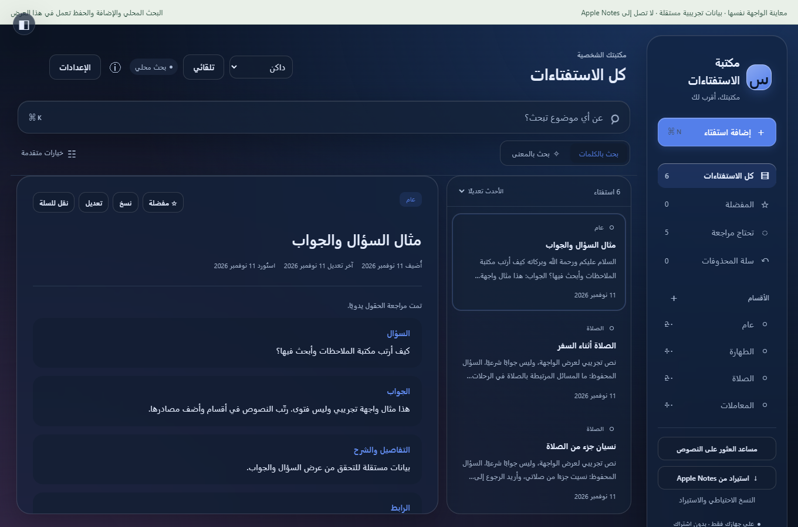

## مساعد المكتبة الجديد — تحديث 1.0.3

[تحميل التحديث الصغير — حوالي ٣٠٠ كيلوبايت](https://github.com/MahdiBAQER27/istiftaat-mac/releases/download/v1.0.3-preview/Istiftaati-Mac-Update-1.0.3.zip)

أشرطة نتائج مختصرة تتوسع عند الضغط لعرض النص كاملًا. من «وضع المساعد» تختار شات المكتبة أو بحث الكلمات أو بحث المعنى. الشات يتابع نتائج مكتبتك وطلبات مثل «الثاني كامل» و«المزيد»، ولا يحتاج نموذجًا إضافيًا أو خدمة مدفوعة.

بحث الكلمات لا يشغّل نموذج المعنى. جرى تقليل إعادة معالجة النصوص ونسخ السجل وإعادة تحميل النموذج، مع بقاء الفهرسة الأولى أبطأ. صور المعاينة التالية فعلية ببيانات تجريبية على Windows؛ ليست صورًا مزعومة من ماك.

---
## الواجهة الزجاجية في تحديث 1.0.2

فاتح وداكن مع ألوان أزرق لؤلؤي ونعناعي وبنفسجي. الكلاسيكي باقٍ بزر التبديل؛ وخيار تقليل المؤثرات في الإعدادات للأجهزة الأبطأ.

هذه صور من تشغيل المعاينة على Windows وليست صورًا مزعومة لتشغيل macOS.

تحسين اكتشاف الأقسام يستبعد التحيات والأرقام ويستخدم تمثيل السؤال، ويترك الاقتراحات غير المؤكدة للمراجعة. عند غياب عنوان «السؤال» يمكن اقتراح النص الموجود قبل «الجواب:». يستمر الاحتفاظ بالأصل؛ لا يوجد ضمان لصحة كل اقتراح، وPDF ليس ضمن هذا التحديث.

---
## تحديث صغير للتطبيق الموجود: 1.0.3

[تحميل التحديث الصغير — حوالي ٣٠٠ كيلوبايت](https://github.com/MahdiBAQER27/istiftaat-mac/releases/download/v1.0.3-preview/Istiftaati-Mac-Update-1.0.3.zip)

أغلق التطبيق بـ Command Q، فك ملف التحديث على الماك وافتح UPDATE-MAC.command. يستخدم التطبيق والنموذج الموجودين، ولا يعيد إنشاء مكتبتك. يضيف قراءة Notes المجمعة وشريط تقدم بعد اختيار الفولدر. [التعليمات وحدود الاختبار](https://github.com/MahdiBAQER27/istiftaat-mac/releases/tag/v1.0.3-preview).

للتثبيت أول مرة: نزّل النسخة الكاملة المناسبة أدناه، ثم طبّق التحديث الصغير. مثبت التحديث تجريبي ولم يُنفّذ على macOS في بيئة التطوير؛ يحتفظ بالتطبيق القديم ولا يلمس بيانات المستخدم.

---
# مكتبة الاستفتاءات للماك

تطبيق عربي مجاني لتنظيم الملاحظات والاستفتاءات، مع بحث محلي بالكلمات وبالمعنى، ومساعد للعثور على النصوص المحفوظة.

## تنزيل التطبيق

افتح [صفحة تنزيل نسختي الماك](https://github.com/MahdiBAQER27/istiftaat-mac/releases/tag/v1.0.0-preview).

- **Apple Silicon:** لأجهزة Apple M1 وM2 وM3 وما بعدها. حمّل Istiftaati-Mac-Apple-Silicon.zip.
- **Intel:** لأجهزة الماك بمعالج Intel. حمّل Istiftaati-Mac-Intel.zip.
- يتطلب macOS 13 أو أحدث بحسب إعداد الحزمة.

فك ZIP على الماك، ثم انقل Istiftaati.app إلى Applications وافتحه.

## استيراد فولدر Notes كاملًا

من التطبيق اختر «استيراد من Apple Notes»، ثم اختر الفولدر مرة واحدة. يقرأ التطبيق الملاحظات الموجودة داخله ومجلداته الفرعية، دون مشاركة كل ملاحظة منفردة. تبقى الأصول في Notes. الاستيراد نصي؛ لا ينقل الصور والمرفقات أو الملاحظات المقفلة.

راجع السؤال والجواب مقابل الأصل قبل التأكيد. يمكنك مراجعة الكل أو عينة كل خمسة أو المراجعة لاحقًا. يتوفر أيضًا استيراد النص المنسوخ والملفات النصية.

## الميزات

- بحث عربي بالكلمات وبالمعنى؛ النموذج موجود داخل الحزمة، بلا اشتراك أو مفتاح API.
- تصنيف مقترح قابل للمراجعة والتعديل، مع أعداد النصوص في الأقسام.
- سؤال وجواب وشرح ومرجع ورابط وتاريخ، مع حفظ الأصل.
- مساعد استرجاع بسجل محادثة محفوظ محليًا؛ لا يؤلف فتاوى أو يتحقق من صحة الأحاديث.
- تصميم كلاسيكي وجديد بزر تبديل، مع فاتح وداكن مستقلين.
- نسخ احتياطية وسلة واستعادة وحماية التعديلات عند إعادة الاستيراد.

## حالة النسخة قبل التجربة

**نسخة تجريبية أولية، وليست إصدارًا نهائيًا مُثبتًا على الماك.** اختُبرت وظائف الحفظ والواجهة والبحث في بيئة Windows/Electron، وفُحصت بنية حزم الماك. تشغيل macOS واستيراد Notes الحقيقي لم يُختبرا بعد. احتفظ بأصولك وابدأ بخمس ملاحظات مستقلة للتأكد قبل إدخال مكتبة كبيرة.

الحزمة موقعة محليًا ad-hoc، وليست موثقة لدى Apple. إذا ظهر تحذير مطوّر مجهول، راجع [إرشادات Apple](https://support.apple.com/en-us/102445). لا تتجاوز تحذير ضرر أو تلف. لا تحتاج تثبيت Node أو Python أو نموذج ذكاء إضافي.
